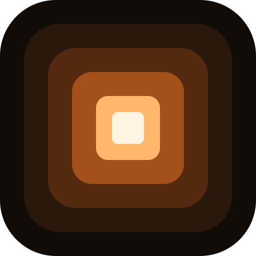

<h1>&nbsp;chimenodes</h1>

A ChimeraX bundle that emulates the look of [MolecularNodes](https://github.com/BradyAJohnston/MolecularNodes).

**Showcase:** [slides](https://anirudhbhashyam.github.io/chimenodes/)

## Install

Requires [UCSF ChimeraX](https://www.cgl.ucsf.edu/chimerax/download.html) >= 1.8,
curl, and either `sha256sum` or `shasum`.

```sh
curl -fsSL https://raw.githubusercontent.com/anirudhbhashyam/chimenodes/main/install.sh -o chimenodes-install.sh &&
    sh chimenodes-install.sh
```

The installer downloads the prebuilt wheel from the v1.0.7 GitHub release,
verifies its SHA-256 checksum, and installs it for the current user.
It finds ChimeraX on macOS, Linux and Windows
(Git Bash) and stops with download instructions if it is missing (the ChimeraX license must be
accepted by you, so it is never downloaded automatically).

Use `sh chimenodes-install.sh --chimerax /path/to/ChimeraX` for a custom ChimeraX
location, or `sh chimenodes-install.sh --help` to list the options.

## Editable install (development)
Editable install, any platform:

  python scripts/dev_install.py            # or scripts/dev_install.sh / .bat

This finds ChimeraX (or use `--exe PATH` / `CHIMERAX_EXE`) and runs
`devel install . editable true`. Or from the ChimeraX command line: `devel install /path/to/chimenodes editable true`.

## Usage
    chimenodes preset neon              # apply a preset (turns rendering on)
    chimenodes glow 1.5 bloomRadius 0.4 # explicit keywords override the preset
    chimenodes glow /A:10-20 strength 3 color gold   # per-object emission
    chimenodes off | on | toggle | reset | info
    chimenodes export blender ~/out/prot.cif

Keywords: `glow bloomRadius bloomThreshold bloomKnee glowLight glowLightRadius exposure tonemap(none|aces|filmic|agx)
ao aoRadius rim dof aperture focus outline vignette grain fxaa quality(draft|normal|high)`.
Values are clamped to valid ranges. `chimenodes preset save|delete|list NAME` manages presets.

## Presets
`mn_default` (MolecularNodes look), `neon` (strong glow), `cinematic` (DOF, vignette, grain),
`clean` (flat, outlined), `inspect` (neutral, for analysis).

## Blender export
`chimenodes export blender PATH` writes the structure, `PATH.chimenodes.json` (camera, colours,
representation, glow) and `render_blender.py`. Then:
`blender -b -P render_blender.py -- prot.cif out.png`.

## Limitations
- Requires OpenGL 3.3 core; on failure the bundle logs once and falls back to stock rendering.
- Blender export is approximate: MolecularNodes may recentre the structure and its API varies
  by release; colours/glow are advisory.
- Screen-space AO/DOF/outline are approximations of the Blender look, not a path tracer.

## Development
    uv run --no-project --with pytest --with numpy pytest tests -rPs
    python -m pytest tests/unit                      # pure Python, no ChimeraX
    ChimeraX --nogui --offscreen --exit --script tests/bench/bench.py

The full suite runs the GL invariants inside ChimeraX when it finds an executable
and can use an OpenGL context. Set `CHIMERAX_EXE` to select a specific executable.
ChimeraX's bundled Python also needs pytest. On macOS the GL run opens a ChimeraX
window briefly.

See `docs/ARCHITECTURE.md` and `docs/user-guide.md`.
